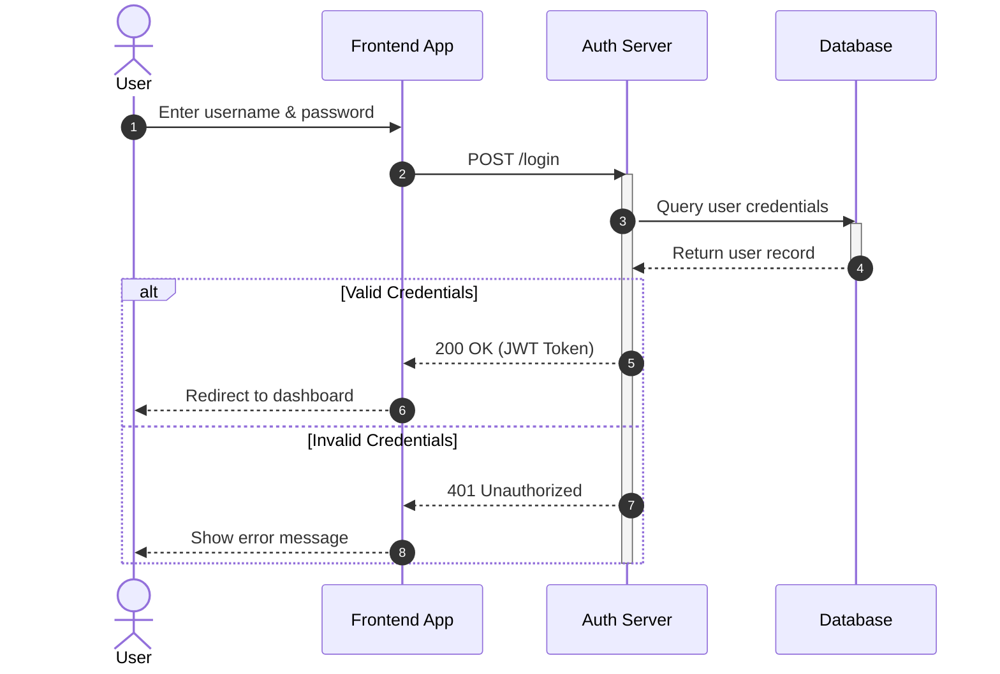

# General info

Simple tool for searching text in files. Only supports plain text files, no binary formats such as Word or PDF.

I was looking for a decent tool to search through my markdown files.  
Windows search however is too cumbersome. 

# Remarks

Currently only tested on Windows.

!! Deprecated.

From test branch.
New.

